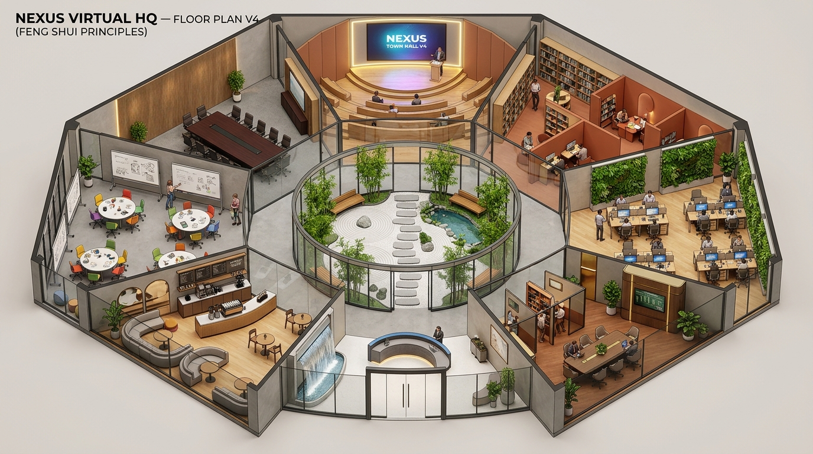

# NEXUS VIRTUAL HQ — Lantai 12 (Versi 4: Feng Shui Edition)

Aplikasi dan spesifikasi desain tata ruang interaktif **Kantor Virtual Spasial (1,250 m²)** yang memadukan prinsip arsitektur **Feng Shui Klasik (Peta Bagua 8-Sektor & 5 Elemen Wu Xing)** dengan teknologi **Spatial Audio & WebRTC**.



---

## 📁 Struktur Berkas Deliverables

| Berkas | Keterangan |
| :--- | :--- |
| [`index.html`](./index.html) | Antarmuka web interaktif utama dengan 4 mode tampilan (*Visual 2.5D*, *Bagua & Qi Flow*, *Blueprint CAD*, *Radar Audio*). |
| [`app.js`](./app.js) | Engine kanvas 2D/2.5D, navigasi avatar, partikel sirkulasi *Qi*, synthesizer suara air mancur Zen (*Web Audio API*), dan kalkulasi audio spasial. |
| [`styles.css`](./styles.css) | Desain antarmuka *dark-mode glassmorphism*, palet 5 elemen Wu Xing, dan layout responsif. |
| [`package.json`](./package.json) | Konfigurasi metadata proyek dan skrip peluncuran. |
| [`floor_plan_v4_feng_shui.jpg`](./floor_plan_v4_feng_shui.jpg) | Render denah arsitektur 3D *isometric cutaway* beresolusi tinggi (Versi 4). |
| [`floorplan-v4-feng-shui-specification.md`](./floorplan-v4-feng-shui-specification.md) | Dokumen spesifikasi teknis lengkap, tabel zoning 8 sektor Bagua, dan protokol kerja virtual. |

---

## 🚀 Cara Menjalankan Aplikasi Web

### Opsi 1: Menggunakan Python (Tanpa Instalasi Tambahan)
```bash
cd ~/Projects/kantor
python3 -m http.server 3000
```
Buka peramban di: `http://localhost:3000`

### Opsi 2: Menggunakan Node / npx
```bash
cd ~/Projects/kantor
npm run serve
# atau
npx serve .
```

---

## 🎮 Kontrol & Fitur Interaktif

- **Navigasi Avatar:**
  - `W`, `A`, `S`, `D` atau `Tombol Panah`: Berjalan mengitari ruangan kantor.
  - `Klik Kiri pada Lantai`: Avatar otomatis berjalan mulus ke lokasi yang diklik.
  - `Klik Kiri pada Ruangan`: Membuka laci inspeksi (*Room Inspector Drawer*) untuk melihat spesifikasi, kapasitas, fasilitas, dan rekan yang aktif di ruangan tersebut.
- **Mode Tampilan:**
  1. **Visual 2.5D:** Render warna modern dengan pencahayaan hangat dan tekstur interior.
  2. **Bagua & Qi Flow (☯):** Menampilkan batas 9 sektor Bagua dan partikel energi *Qi* yang mengalir dari pintu masuk Utara ke Atrium Pusat.
  3. **Blueprint CAD:** Denah teknis cetak biru arsitektur lengkap dengan dimensi bangunan (*meter*).
  4. **Radar Audio:** Heatmap sebaran suara spasial dan amplop isolasi suara kedap ruangan.
- **Harmoni Suara Alam (Web Audio API):**
  - Tombol synthesizer suara: Hening, Air Mengalir Zen, Cafe Santai, Hujan LoFi, dan White Noise kantor.
- **Ekspor Gambar:**
  - Klik tombol unduh di pojok kanan bawah kanvas untuk mengunduh denah versi aktif sebagai berkas gambar PNG.

---

## ☯ Ringkasan Penataan Ruang 8 Sektor Bagua

1. **Utara (Kan • Air):** Lobi & Resepsionis Digital dengan Air Mancur Mengalir (*Mulut Qi / Karir*).
2. **Pusat (Tai Qi • Tanah):** Atrium Zen Terbuka & Kolam Koi (*Jantung Keseimbangan & Harmoni*).
3. **Barat Laut (Qian • Logam):** Boardroom Garuda & Posisi Komando (*Kepemimpinan Tertinggi & Direksi*).
4. **Tenggara (Xun • Kayu):** Strategy & Wealth Suite (*Kemakmuran, Finansial & Pendanaan*).
5. **Timur (Zhen • Kayu):** Klaster Inovasi & Rekayasa Teknologi (*Pertumbuhan Cepat & Inovasi*).
6. **Barat (Dui • Logam):** Studio Desain Kreatif & Sprint Merapi (*Kreativitas Murni & Ideasi*).
7. **Selatan (Li • Api):** Auditorium Nusantara (*Reputasi Global, Ketenaran & All-Hands*).
8. **Timur Laut (Gen • Tanah):** The Silent Library & Bilik Fokus Solo (*Kebijaksanaan & Deep Work*).
9. **Barat Daya (Kun • Tanah):** Warung Kopi & Social Breakout Lounge (*Harmoni Hubungan & Empati*).

*Seluruh sudut partisi dan meja kerja menggunakan desain melengkung (rounded corners) untuk mengeliminasi Sha Qi (sudut beracun).*
