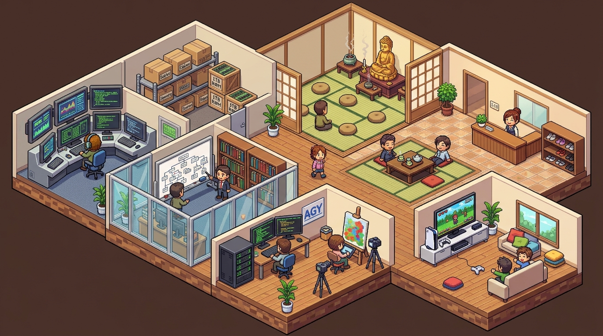

# Aspirasi dan Perencanaan Studio Kantor Virtual AI 3D

| Dokumen | Visi, Arsitektur & Perencanaan Kantor AI | Tanggal | 2026-11-08 |
| :--- | :--- | :--- | :--- |
| **Proyek** | `kantor` (`https://kantor.weiwu.my.id`) | **Pemilik** | `clouduser` |
| **Visualisasi** | Three.js 3D Simulation Engine (Kairosoft 3D Voxel/Pixel Style) | **Asset Render** | Agy Artist (Subagent agy) |

---

## 1. Visi & Filosofi Dasar

Membangun ekosistem kerja kecerdasan buatan (*Autonomous AI Studio*) yang hidup, kolaboratif, dan terorkestrasi secara nyata, di mana aktivitas kerja multi-agent divisualisasikan dalam bentuk **simulasi kantor virtual 3D bergaya retro-tycoon Kairosoft** berbasis Three.js.

Prinsip utamanya adalah **Separation of Concerns (SoC) & Token Efficiency**:
1. **Pemisahan Peran Agentik yang Tegas:** Setiap entitas memiliki spesialisasi dan profil beban/biaya yang terukur.
2. **Zero-Token Visual Gaming Loop:** Animasi karakter (idle, nafas, menyeruput kopi, jalan-jalan, main game, meditasi, ngobrol) dijalankan oleh *deterministic game loop* (`requestAnimationFrame`) di browser pada 60 FPS, **bukan oleh token LLM**. LLM hanya memancarkan paket data diskrit (*event telemetry*) saat terjadi perubahan state kerja.
3. **Representasi Fisik Telemetri Server:** Metrik teknis server (seperti penggunaan RAM memori) direpresentasikan secara visual dan intuitif sebagai objek fisik kantor (misal: tumpukan boks logistik di *Storage Room*).

---

## 2. Kuartet Persona & Pembagian Peran

```
                  [ Input: Telegram / Webhook / Task Trigger ]
                                       │
                                       ▼
                          ┌────────────────────────┐
                          │  HERMES (Orchestrator) │  <── Always-on Server Daemon
                          │   • Task Dispatcher    │      Event Bus & Queue
                          │   • Cron & Scheduler   │
                          └───────────┬────────────┘
                                      │
                         Dispatches Strategic Scope
                                      │
                                      ▼
                          ┌────────────────────────┐
                          │ CLAUDE CODE (Architect)│  <── High-Level Analyst
                          │   • Strategic Planning │      Deep Reasoning / ADR
                          │   • System Review Gate │
                          └───────────┬────────────┘
                                      │
                   ┌──────────────────┴──────────────────┐
                   ▼                                     ▼
      ┌────────────────────────┐             ┌────────────────────────┐
      │ AGY (Engineer & Artist)│             │ CODEX (Second Opinion) │
      │ • Technical Code Exec  │             │ • PRD / Code Review    │
      │ • Visuals & Agy Artist │             │ • Objective Analysis   │
      │ • TDD & AST Refactor   │             │ • (Menunggu Pemilik)   │
      └───────────┬────────────┘             └───────────┬────────────┘
                  │                                     │
                  └──────────────────┬──────────────────┘
                                     │
                    Telemetri Event (JSON over SSE/WS)
                                     ▼
                     ┌────────────────────────────────┐
                     │ Three.js 3D Office Simulation  │
                     │  (Client-side Game Loop 60FPS) │
                     └────────────────────────────────┘
```

### Profil Entitas

| Persona / Mesin | Peran Utama | Profil Beban & Biaya | Output Utama |
| :--- | :--- | :--- | :--- |
| **Hermes** *(Nous Research)* | **The Orchestrator & Operator** | Always-on background daemon, low CPU/RAM | Routing tugas, cron scheduler, event dispatching, gateway komunikasi (Telegram, webhook) |
| **Claude Code** | **The Chief Architect & Planner** | High-level reasoning, high-cost | Dokumen spesifikasi (PRD/TSD), task DAG breakdown, review mutu arsitektur |
| **Antigravity (AGY)** | **The Lead Programmer & Virtual Artist** | Deep technical execution, visual assets | Implementasi kode bedah presisi (AST edits), loop TDD (Red-Green-Refactor), pembuatan aset visual via subagent Agy Artist |
| **Codex** | **The Reviewer & Second Opinion** *(menunggu keputusan pemilik)* | Evaluasi kritis & second opinion | Review teks, kritik dokumen PRD/arsitektur, second opinion teknis objektif |

---

## 3. Floor Plan Kantor Virtual (Versi 2 — Kairosoft 3D Voxel/Pixel Style)

Pada pembaruan Versi 2, studio berkembang menjadi ekosistem yang utuh dengan nuansa visual **3D Isometric Pixel / Voxel Art khas Kairosoft** (*Game Dev Story* diorama). Ruang kantor tidak hanya memuat workstation, tetapi juga fasilitas kesejahteraan mental (*mental wellbeing*), hiburan, serta ruang representasi hardware server.



### Rincian 8 Zona Kantor Virtual Versi 2:

1. **Office Lobby & Sunken Tatami Lounge:**
   * Meja resepsionis kayu dengan sprite resepsionis yang ramah menyambut tamu/pesan masuk.
   * Rak sepatu / loker pegawai di sisi dinding masuk.
   * **Area Duduk Sunken Tatami (*Horigotatsu*):** Meja kayu rendah dengan bantalan duduk merah di lantai tatami bertingkat ke bawah untuk suasana diskusi informal santai.

2. **Hermes Command Desk:**
   * Konsol pusat berbentuk modul heksagonal retro-cyber dengan monitor tabung ganda hijau dan biru menampilkan status antrean, routing data, dan status operasional sistem.
   * Avatar operator bersiaga mengarahkan paket instruksi ke tim lainnya.

3. **Claude Strategy Room:**
   * Ruang rapat tertutup dengan meja rapat kayu, kursi rapat, rak buku strategi, serta papan tulis (*whiteboard*) besar yang memajang diagram alir arsitektur sistem.
   * Tempat Claude merumuskan rencana induk sebelum kode ditulis.

4. **AGY Engineering Bay:**
   * Stasiun kerja teknis intensif dengan dua meja developer penuh setup *triple-monitor* bersudut yang menampilkan kode baris dengan *syntax highlighting*.
   * Dua rak server raksasa (*server rack towers*) dengan kabel data di lantai dan lampu LED indikator hijau yang terus berkedip saat build / test dijalankan.

5. **Art Atelier (agy):**
   * Studio kreasi seni visual yang dilengkapi kuda-kuda kanvas (*easel*) dengan lukisan warna-warni kreasi artist agy, kamera DSLR pada tripod, meja komputer grafis dengan tablet pen, serta dinding galeri mini (*moodboard*). Pelukis resmi kantor adalah **agy** via subagent artist miliknya.

6. **Meditation Room (Ruang Meditasi Zen):**
   * Ruangan hening berlantai tatami alami.
   * Dilengkapi altar dengan **rupang Buddha berwarna emas**, lilin, mangkuk dupa dengan kepulan asap dupa wangi yang meliuk lembut, bantalan meditasi (*zafu*), dan gulungan kaligrafi Zen di dinding.
   * Tempat para agent "rehat sejenak" (*mindfulness / context reset*).

7. **Game Room (Ruang Rekreasi):**
   * Ruang hiburan untuk santai saat antrean tugas kosong (*idle time*).
   * Dilengkapi konsol **PlayStation 5 (PS5)** ramping warna putih, TV flat screen 40 inci menampilkan game pixel retro, stik controller di atas meja, sofa empuk abu-abu, dan poster game dev di dinding.

8. **Storage Room (Representasi Pemakaian RAM Server):**
   * Ruang gudang logistik dengan rak-rak besi industri yang dipenuhi tumpukan boks/kardus berlabel memori.
   * **Mekanisme Visualisasi:** Jumlah tumpukan boks secara dinamis bertambah atau berkurang di Three.js sesuai dengan persentase memori RAM server yang sedang terpakai (*RAM footprint telemetri*). Semakin berat beban proses server, semakin penuh tumpukan boks di gudang.

---

## 4. Arsitektur Teknis: Game Loop vs Telemetri Agent

### A. Aliran Telemetri Diskrit (Beban Ringan)
Agent tidak mengontrol koordinat gerakan karakter setiap frame. Sebaliknya, agent hanya memancarkan sinyal status ketika fase kerja berubah melalui endpoint API lokal (`POST /api/events`):

```json
{
  "source": "agy",
  "persona": "alex",
  "type": "task.start",
  "task_id": "TASK-2026-11-08-01",
  "title": "Refactoring auth_middleware.go (TDD Loop)",
  "level": "technical",
  "state": "CODING",
  "system_metrics": {
    "ram_used_percent": 68.5,
    "storage_boxes_target": 14
  }
}
```

### B. State Machine Animasi (Client-Side Three.js)

Browser membaca event melalui Server-Sent Events (`SSE /api/stream`) dan state machine lokal mengendalikan animasi tanpa biaya token:

| State | Animasi Karakter (60 FPS Game Loop) | Efek Lingkungan di 3D |
| :--- | :--- | :--- |
| `IDLE` | Berjalan ke Game Room (main PS5), duduk di Sunken Tatami menyeruput teh, atau meditasi di Meditation Room. | Suasana santai, animasi sprite santai 8-bit/16-bit. |
| `MEDITATING` | Duduk bersila di atas bantalan tatami di depan altar Buddha, nafas teratur. | Asap dupa melayang perlahan, ambient warm light. |
| `PLANNING` (Claude) | Berdiri di depan papan tulis ruang strategi, menunjuk diagram. | Whiteboard diagram terupdate secara dinamis. |
| `DISPATCHING` (Hermes) | Mengetik di konsol retro Hermes. | Layar CRT berkedip cepat memancarkan data. |
| `CODING` (AGY) | Mengetik cepat di multi-monitor stasiun teknis. | Kode scrolling di layar monitor, LED server rack berkedip kencang. |
| `CREATING` (AGY) | Menggores kuas di kanvas lukis Art Atelier. | Kanvas ter-render indah. |
| `REVIEWING` (Codex) | Menelaah dokumen dan kode di meja kerja. | Monitor menampilkan draf teks. |
| `MEMORY_SPIKE` | Operator/kurir membawa boks tambahan ke Storage Room. | Rak gudang bertambah tumpukan kardus RAM. |

---

## 5. Rencana Integrasi & Tahapan Implementasi

Sesuai dengan basis kontrak teknis di [`docs/TSD-KANTOR-v0.1.md`](./TSD-KANTOR-v0.1.md):

1. **Fase Ingestion & Data Layer (Core Ready):**
   * Backend Node.js 24 (`node:http`, `node:sqlite`) melayani ingest event dan stream SSE.
   * Tabel SQLite `events`, `tasks`, dan `usage` mencatat riwayat dan token burn.
2. **Fase Visualisasi 3D Scene Assembly (Kairosoft Style):**
   * Integrasi aset 3D / geometri voxel modular (voxel meshes / pixel-textured low-poly blocks) untuk 8 zona ruangan.
   * Sunken Tatami floor geometry & Meditation altar props.
   * Dynamic RAM Storage Box generator di `src/storage.ts` berdasarkan metrik `os.totalmem()` dan `os.freemem()`.
3. **Fase Agent Hook & Bridge:**
   * Memasang hook Claude Code (`UserPromptSubmit`, `Stop`, `SubagentStart`) agar otomatis memicu state visual.
   * Skrip wrapper AGY (`tools/kantor-agy.sh`) untuk merefleksikan aktivitas teknis real-time.
   * Hermes / Director adapter untuk mengatur adegan santai (main game, ngopi, meditasi) saat tidak ada antrean kerja aktif.

---
*Dokumen ini merupakan pedoman visi arsitektur studio dan referensi teknis integrasi lintas agent.*
