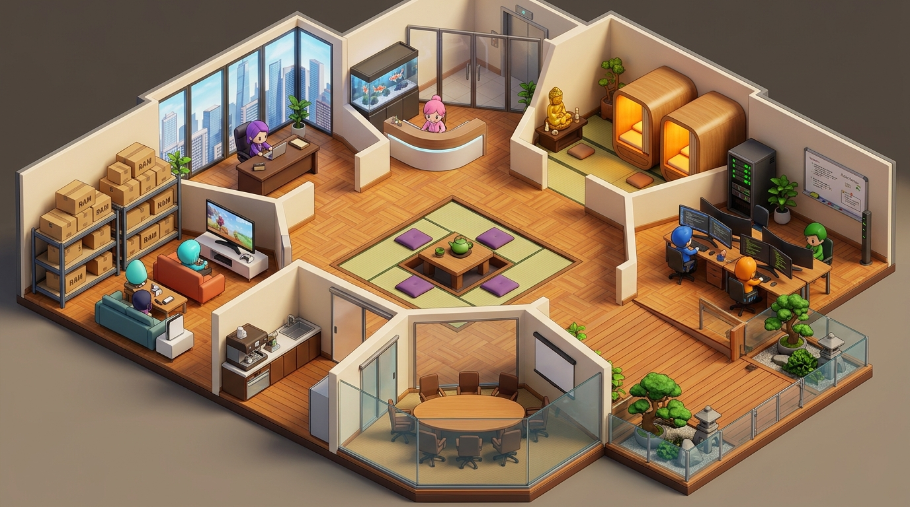

# KANTOR WEIWU — Spesifikasi Tata Ruang: Versi 6 (Skyline Tatami & Feng Shui Edition — Lantai 20)

| Proyek | **Kantor Weiwu** (`https://kantor.weiwu.my.id`) | Versi | **Floorplan v6 (Skyline Tatami Edition)** |
| :--- | :--- | :--- | :--- |
| **Lokasi Naratif** | Lantai 20 Gedung Pencakar Langit (*High-Rise Skyscraper 20th Floor*) | **Gaya Visual** | 2.5D Isometric Pixel/Voxel Art Kairosoft (*Game Dev Story* diorama) |
| **Prinsip Interior** | Feng Shui Bagua 8-Sektor, 5 Elemen (Wu Xing), & Safety-First Architecture | **Basis Desain** | Penggabungan keunggulan **v5 & v3** dengan 6 Fasilitas Baru |

---



---

## 1. Visi Desain & Evolusi Ruang (Floorplan v6)

Mengadopsi seluruh filosofi inti **Floorplan v5** yang disukai pemilik dan memperkaya variasi ruangan setara **Floorplan v3**, Versi 6 menghadirkan adaptasi ruang kerja virtual bertingkat tinggi (*Skyline Office Lantai 20*).

### 6 Fasilitas Baru & Preferensi Pemilik:
1. **Garden Area di Balkon (Sky Garden):** Terletak di sayap luar dengan konsep taman Zen Jepang outdoor.
   - **Safety First:** Pagar pengaman kaca tempered laminasi berlapis ganda setinggi 1.8 meter dengan rangka *stainless steel* struktural, ditambah parit tanaman (*planter box buffer*) sebagai batas pengaman ganda (*double perimeter*) untuk menjamin keamanan di ketinggian lantai 20.
2. **Outdoor Hallway / Sky Corridor:** Lorong dek kayu terbuka/semi-outdoor yang menghubungkan ruang kantor internal dengan balkon luar, memberikan sensasi hembusan udara segar dan transisi spasial yang nyata di lantai 20.
3. **Executive Room (Ruang Pimpinan):** Ruang privat berkelas tinggi dengan **jendela kaca panorama raksasa (*floor-to-ceiling panoramic glass*)** menghadap lanskap gedung pencakar langit kota metropolitan. Meja eksekutif diletakkan pada **Posisi Komando (*Commanding Position*)** sempurna membelakangi dinding kokoh dan memantau akses masuk.
4. **Meeting Room (Kapasitas 6-8 Pax):** Ruang presentasi berpartisi kedap suara dengan meja konferensi oval kayu halus, 8 kursi ergonomis, dan layar *smart board presentation* 75 inci di dinding.
5. **Dedicated Closed Pantry:** Bukan sekadar meja konter terbuka di lorong, melainkan ruangan tertutup khusus dengan pintu geser *shoji* modern untuk menjaga higienitas, aroma kopi, dan ketenangan area kerja.
6. **Japanese Sleeping Pods:** Fasilitas kapsul tidur modern berbalut kayu hinoki hangat dan tatami untuk *power nap* dan restorasi energi agen saat jeda antrean tugas.

---

## 2. Peta Zonasi 9 Ruangan Berdasarkan 8 Sektor Bagua & 5 Elemen

```
┌─────────────────────────────────┬─────────────────────────────────┬─────────────────────────────────┐
│     BARAT LAUT (Logam / Qian)   │         UTARA (Air / Kan)       │     TIMUR LAUT (Tanah / Gen)    │
│          EXECUTIVE ROOM         │      LOBI UTAMA "KANTOR WEIWU"  │      MEDITATION & SLEEP PODS    │
│ Jendela panorama skyscraper,    │ Resepsionis, akuarium koi flow, │ Altar Buddha emas Betty &       │
│ meja komando kayu eksekutif     │ gerbang lift lantai 20          │ 2 Kapsul istirahat (power nap)  │
├─────────────────────────────────┼─────────────────────────────────┼─────────────────────────────────┤
│        BARAT (Logam / Dui)      │       PUSAT (Tanah / Tai Qi)    │        TIMUR (Kayu / Zhen)      │
│      GAME ROOM & RAM DEPOT      │      SUNKEN TATAMI LOUNGE       │      WORK ROOM & DEV BAY        │
│ TV 40", konsol game putih &     │ Ceruk horigotatsu, teko teh     │ 4-6 meja multi-monitor Alex,    │
│ rak kardus telemetri RAM server │ kayu rendah, bantal ungu Greg   │ Windry & Codex + server rack    │
├─────────────────────────────────┼─────────────────────────────────┴─────────────────────────────────┤
│      BARAT DAYA (Tanah / Kun)   │        SELATAN (Api / Li)       │     TENGGARA (Kayu / Xun)       │
│      DEDICATED CLOSED PANTRY    │        MEETING ROOM 6-8 PAX     │   BALKON GARDEN & SKY HALLWAY   │
│ Ruang tertutup, mesin espresso, │ Meja rapat oval, layar presentasi│ Hallway dek outdoor, taman Zen, │
│ kulkas, kitchen sink higienis   │ interaktif & partisi kedap suara│ safety glass 1.8m lantai 20     │
└─────────────────────────────────┴─────────────────────────────────┴─────────────────────────────────┘
```

---

## 3. Matriks Sektor Bagua, Elemen, & Ergonomi Tata Ruang

| Sektor Mata Angin | Trigram Bagua | Elemen Wu Xing | Ruangan | Fitur Kairosoft & Prinsip Feng Shui |
| :--- | :--- | :--- | :--- | :--- |
| **Utara (North)** | **Kan (坎)** | 💧 **Air (Water)** | **Lobi Utama Kantor Weiwu** | *The Mouth of Chi*. Titik masuk aliran rezeki dari lift lantai 20. Resepsionis ramah, akuarium koi air tenang, papan nama retro kayu berpiksel. |
| **Barat Laut (North-West)** | **Qian (乾)** | ⚪ **Logam (Metal)** | **Executive Room (Pimpinan)** | Sektor Pemimpin Tertinggi. Jendela kaca raksasa dengan pemandangan kota/awan lantai 20. Meja kayu solid di posisi komando diagonal pintu dengan penopang dinding kokoh (*Black Tortoise*). |
| **Timur Laut (North-East)** | **Gen (艮)** | ⛰️ **Tanah (Earth)** | **Meditation & Sleeping Pods** | Sektor Gunung & Kebijaksanaan. Altar Buddha emas, dupa wangi Betty, plus 2 bilik *Japanese Capsule Sleeping Pod* tatami berlampu tidur hangat redup 2200K. |
| **Pusat (Center)** | **Tai Qi (太极)** | ⛰️ **Tanah (Earth)** | **Central Sunken Tatami Lounge** | Titik netral gravitasi energi. Ceruk *horigotatsu* berlantai tatami alami, bantal beludru ungu (`#6d4fd8`), teko teh hijau keramik untuk diskusi santai. |
| **Timur (East)** | **Zhen (震)** | 🌳 **Kayu (Wood)** | **Work Room & Dev Bay** | Sektor Fajar & Pertumbuhan Ide. 4-6 meja kayu triple-monitor Alex & Windry & Codex, papan tulis diagram, rak server mini dengan LED hijau berkedip. |
| **Tenggara (South-East)** | **Xun (巽)** | 🌳 **Kayu (Wood)** | **Balkon Garden & Outdoor Hallway** | Sektor Kemakmuran. Lorong dek kayu lantai 20 menuju taman Zen terbuka: batu koral, bonsai pinus, meja teh outdoor, dan **pagar tempered glass 1.8m (Safety First)**. |
| **Selatan (South)** | **Li (离)** | 🔥 **Api (Fire)** | **Meeting Room (6-8 Pax)** | Sektor Ketenaran & Ekspresi Visi. Meja oval anti-sudut tajam (*anti-Sha Qi*), layar display presentasi 75", partisi kaca kedap suara untuk pitch & koordinasi. |
| **Barat Daya (South-West)** | **Kun (坤)** | ⛰️ **Tanah (Earth)** | **Dedicated Closed Pantry** | Sektor Keharmonisan & Hubungan Manusia. Ruangan tertutup berpintu geser, mesin espresso barista, kitchen sink, microwave, kulkas, tempat rehat kopi Hermes. |
| **Barat (West)** | **Dui (兑)** | ⚪ **Logam (Metal)** | **Game Room & RAM Depot** | Sektor Rekreasi & Kapasitas. TV 40", sofa empuk, konsol putih untuk *zero-token idle loop*, berdampingan dengan rak besi tumpukan kardus "RAM" telemetri server. |

---

## 4. Analisis Detail 6 Preferensi Tambahan

### A. Garden Area di Balkon & Protokol Safety First
* **Ketinggian:** Lantai 20 memiliki terpaan angin dan risiko elevasi tinggi.
* **Perlindungan Berlapis (*Double Perimeter Safety*):**
  1. *Primary Barrier:* Pagar kaca struktural *laminated tempered glass* setinggi 1.8 meter dengan tiang penopang baja antikarat *grade 316*. Kaca bening menjaga visibilitas pemandangan kota tanpa celah yang bisa dipanjat.
  2. *Secondary Buffer:* Palung tanaman (*heavy stone planter boxes*) selebar 50 cm di sisi dalam sepanjang pagar kaca, mencegah karakter berdiri tepat menempel di bibir kaca luar.
* **Elemen Taman:** Lantai decking komposit kayu anti-selip, hamparan batu koral putih, rumpun bambu kerdil penahan angin, serta pohon bonsai pinus Jepang.

### B. Outdoor Hallway (Sky Deck Corridor)
* **Pengalaman Spasial:** Menghubungkan interior kantor berlantai tatami/parket dengan balkon luar melalui pintu geser kaca ganda berbingkai kayu hitam.
* **Atmosfer:** Menghadirkan kesan kantor prestisius di gedung pencakar langit modern yang memiliki akses udara segar alami.

### C. Executive Room (Skyscraper Panoramic View)
* **Posisi Komando:** Terletak di sudut Barat Laut (sektor kehormatan *Qian*).
* **Pemandangan:** Dua sisi dinding kaca penuh menghadap cakrawala gedung-gedung tinggi kota metropolis lantai 20, menciptakan aura wibawa bagi Greg / pimpinan studio.
* **Fasilitas:** Meja kayu eksekutif, kursi putar kulit ergonomis, rak buku strategi, serta area santai untuk tamu VIP.

### D. Meeting Room (6-8 Pax Presentation Suite)
* **Tata Letak:** Meja konferensi berbentuk kapsul/oval untuk memastikan seluruh 6-8 peserta memiliki garis pandang bebas ke layar utama tanpa ada yang terisolasi di sudut.
* **Teknologi Presentasi:** Layar smart interaktif 75 inci di dinding depan dengan soundbar terintegrasi, whiteboard kaca, serta pencahayaan *dimmable presentation mode*.

### E. Dedicated Closed Pantry
* **Pemisahan Fungsional:** Mengisolasi suara blender/grinder kopi dan aroma makanan dari ruang kerja dan meeting room.
* **Interior:** Meja bar kayu L-shape, mesin kopi espresso profesional, wastafel cuci piring higienis, dispenser air hangat/dingin, kulkas, dan kabinet kayu rapi.

### F. Japanese Sleeping Pods (Rest Nook)
* **Kesejahteraan Agen (*Mental Wellbeing*):** Terletak berdampingan dengan Meditation Sanctuary di sudut Timur Laut yang hening.
* **Desain Pod:** 2 kabin kapsul kayu minimalis (*hinoki wood nap pods*) dengan kasur tatami lembut, selimut abu-abu, tirai penutup gulung, lampu baca hangat, serta sistem sirkulasi udara hening.

---

## 5. Distribusi Persona Tim & Jalur Pergerakan (Three.js NavGraph)

| Persona | Spot Default Kerja | Spot Idle Favorit | Jalur Aktivitas Utama |
| :--- | :--- | :--- | :--- |
| **Greg** (Lead) | `desk_executive` (Executive Room) | `sunken_tatami` & `sky_garden` | Memantau dari Executive Room, minum teh di Tatami, rapat di Meeting Room. |
| **Betty** (Admin) | `desk_betty` (Work Room) | `meditation_altar` & `sleep_pod_1` | Meditasi hening di altar Buddha, istirahat di sleeping pod saat jeda tugas. |
| **Alex** (Tech Lead) | `desk_alex` (Work Room) | `game_ps5` & `outdoor_hallway` | Coding intensif di Dev Bay, main game di Game Room, menikmati angin balkon. |
| **Windry** (Tactical) | `desk_windry` (Work Room) | `game_sofa` & `sky_garden` | Memeriksa pipeline di Work Room, santai di balkon luar bersama tim. |
| **Codex** (Reviewer) | `desk_codex` (Work Room) | `meeting_table` & `sunken_tatami` | Menelaah kode di meja kerja, memimpin review di Meeting Room. |
| **Hermes** (Dispatcher)| `pantry_bar` & `lobby_reception` | `pantry_espresso` | Menjaga antrean pesan di lobi/konsol, menyeduh kopi espresso di Closed Pantry. |

---
*Dokumen ini merupakan pedoman arsitektur resmi untuk implementasi visual render dan assembly geometri Three.js Floorplan v6.*
