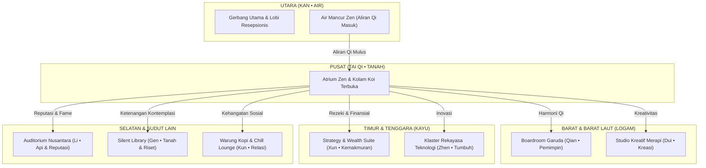

# Blueprint & Spesifikasi Kantor Virtual: Versi 4 (Feng Shui Harmony Edition)


Dokumen ini memuat arsitektur tata ruang komprehensif untuk **NEXUS VIRTUAL HQ — Lantai 12 (Versi 4)** yang telah direstrukturisasi secara menyeluruh menggunakan prinsip-prinsip **Feng Shui Klasik (风水)** yang dipadukan dengan ergonomi ruang virtual dan teknologi audio spasial modern.

---

## 1. Filosofi Desain: Integrasi Bagua & Ergonomi Spasial

Dalam merancang kantor virtual berkinerja tinggi, penataan ruang digital tidak hanya mempertimbangkan efisiensi fungsional, tetapi juga dinamika psikologis dan aliran energi kerja (*Sheng Qi*). 

Model Versi 4 menerapkan konfigurasi **Peta Bagua 8 Sektor (八卦)** dan **Siklus 5 Elemen Wu Xing (五行: Kayu, Api, Tanah, Logam, Air)** untuk menciptakan keseimbangan antara kerja fokus individu, kolaborasi kreatif, dan kesehatan mental tim.

> [!IMPORTANT]
> **Tiga Pilar Feng Shui Versi 4:**
> 1. **Mulut Energi Qi (The Mouth of Chi):** Aliran energi positif masuk dari pintu gerbang Utara (*Kan - Air*) dan dialirkan secara tenang ke seluruh sayap gedung.
> 2. **Jantung Keseimbangan (Tai Qi):** Pusat gedung tidak disekat dinding masif, melainkan dibuka sebagai Atrium Zen dan Kolam Koi terbuka untuk mencegah stagnasi energi.
> 3. **Posisi Komando (Commanding Position):** Meja kepemimpinan dan workstation menghadap diagonal ke arah pintu masuk dengan penopang dinding kokoh di belakang (*Black Tortoise*), menghindari paparan punggung terbuka.

---

## 2. Matriks Tata Ruang Berdasarkan 8 Sektor Bagua & 5 Elemen

| Sektor Mata Angin | Trigram Bagua | Elemen Utama | Fungsi Zona Kantor | Karakteristik Ruangan & Fitur Feng Shui |
| :--- | :--- | :--- | :--- | :--- |
| **Utara (North)** | **Kan (坎)** | 💧 **Air (Water)** | **Lobi Resepsionis & Pintu Masuk** | *Mulut Qi*. Air mancur lengkung bertingkat (*cascading fountain*) menyambut kedatangan, melambangkan rezeki mengalir tenang dan kelancaran karir. |
| **Pusat (Center)** | **Tai Qi (太极)** | ⛰️ **Tanah (Earth)** | **Atrium Zen & Kolam Koi Terbuka** | Titik netral gravitasi energi. Taman batu zen, rumpun bambu hijau, dan jalur melingkar penghubung tanpa koridor buntu. |
| **Barat Laut (North-West)** | **Qian (乾)** | ⚪ **Logam (Metal)** | **Boardroom Garuda (Executive Command)** | Sektor Patriark & Kepemimpinan Tertinggi. Meja rapat mahoni oval, dinding akustik kayu berpenopang kokoh, dan isolasi STC 55. |
| **Tenggara (South-East)** | **Xun (巽)** | 🌳 **Kayu (Wood)** | **Strategy & Wealth Growth Suite** | Sektor Kemakmuran (*Wealth Corner*). Dilengkapi tanaman Jade hias, ornamen kuningan/emas, dan terminal analitik investasi. |
| **Timur (East)** | **Zhen (震)** | 🌳 **Kayu (Wood)** | **Klaster Rekayasa & Inovasi Teknologi** | Sektor Fajar & Pertumbuhan Cepat. Workstation tim engineering & devops berlatar dinding biophilic vertikal untuk kesehatan mata dan stamina. |
| **Barat (West)** | **Dui (兑)** | ⚪ **Logam (Metal)** | **Studio Desain Kreatif & Sprint Merapi** | Sektor Ekspresi & Masa Depan. Meja bundar logam tanpa sudut tajam, papan interaktif Figma/Miro untuk kreasi UI/UX tanpa sekat hierarki. |
| **Selatan (South)** | **Li (离)** | 🔥 **Api (Fire)** | **Auditorium Nusantara (Grand Stage)** | Sektor Ketenaran & Reputasi Global. Panggung megah bertingkat, pencahayaan aksen api hangat, layar presentasi 200", dan spotlight mic. |
| **Timur Laut (North-East)** | **Gen (艮)** | ⛰️ **Tanah (Earth)** | **The Silent Library & Focus Pods** | Sektor Gunung & Pengetahuan. Ketenangan absolut, dinding buku kayu pinus, auto-mute microfon, dan pencahayaan hangat 2700K. |
| **Barat Daya (South-West)** | **Kun (坤)** | ⛰️ **Tanah (Earth)** | **Warung Kopi & Social Breakout Lounge** | Sektor Hubungan Antar Manusia & Empati. Espresso bar barista, sofa lengkung setengah lingkaran, catur, dan suasana santai. |

---

## 3. Prinsip Penangkalan Sudut Beracun (*Sha Qi*) & Ergonomi

> [!TIP]
> **Eliminasi Sha Qi (Sudut Tajam yang Menusuk):**
> - Seluruh partisi dinding kaca, meja kerja, dan pintu geser dibuat dengan radius lengkung minimal 16–24 px (*rounded corners*).
> - Tidak ada meja kerja yang berada tepat di garis lurus pintu masuk (*rushing Chi*) tanpa peredam visual berupa tanaman atau partisi akustik lengkung.
> - Tidak ada pilar atau balok menggantung (*overhead beams*) langsung di atas kepala avatar karyawan saat berada di meja hot-desk.



---

## 4. Rekayasa Akustik & Audio Spasial Versi 4

1. **Acoustic Occlusion Envelope:** Ruangan kategori rapat (*Boardroom*, *Studio Merapi*, *Strategy Suite*) dan fokus (*Library*, *Focus Pods*) dilindungi algoritma *bounding box occlusion* (STC 48–55), mencegah percakapan rahasia bocor ke koridor umum.
2. **Natural Proximity Attenuation:** Di area terbuka (*Klaster Teknologi* dan *Lounge*), kekuatan suara menggunakan model *Inverse-Square Law* dengan radius alami 3.5–4.5 meter, mensimulasikan pertemuan langsung (*watercooler serendipity*).
3. **Harmonic Soundscapes Synthesizer:** Pengguna dapat mengaktifkan sintesis audio frekuensi alamiah:
   - `zenfountain`: Suara tetesan air mengalir yang memicu gelombang otak Alfa (8–12 Hz) untuk relaksasi.
   - `rain`: Hujan LoFi lembut untuk penulisan kode berfokus tinggi.
   - `office`: White noise HVAC teratur untuk menyamarkan distraksi lingkungan rumah.

---

## 5. Cara Menjalankan Aplikasi Web Interaktif Versi 4

Source code aplikasi web interaktif terletak di:
[`/root/.gemini/antigravity-cli/scratch/kantor-virtual-floorplan/`](file:///root/.gemini/antigravity-cli/scratch/kantor-virtual-floorplan/)

### Menjalankan Server Lokal:
```bash
cd /root/.gemini/antigravity-cli/scratch/kantor-virtual-floorplan
python3 -m http.server 3000
```
Buka browser pada port `http://localhost:3000` untuk berinteraksi dengan:
- **Mode Visual 2.5D:** Render warna tekstur furnitur modern.
- **Mode Bagua & Qi Flow (☯):** Menampilkan batas 9 sektor Bagua dan partikel aliran energi Qi interaktif.
- **Mode Blueprint CAD:** Tampilan cetak biru teknis arsitektur lengkap dengan dimensi bangunan.
- **Mode Radar Audio:** Heatmap sebaran suara spasial dan isolasi dinding kedap suara.
- **Avatar Interaktif:** Navigasi karakter dengan tombol `W A S D` atau klik lantai untuk berjalan, claim hot-desk, dan teleportasi ke posisi komando.
